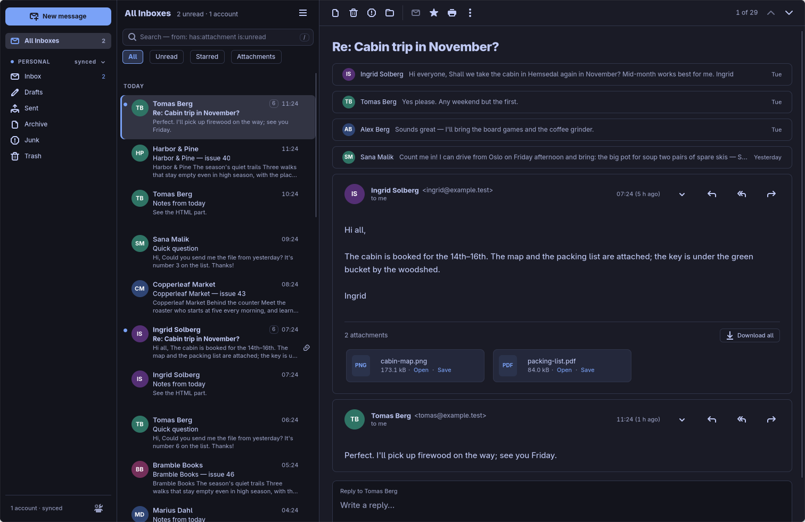
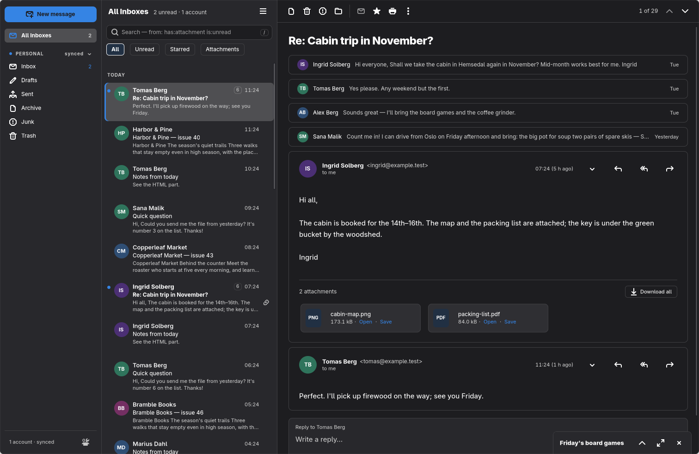
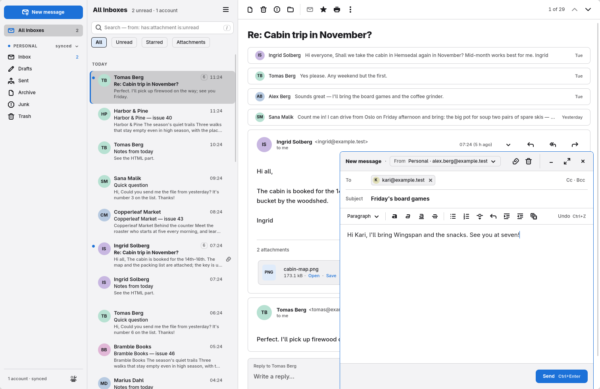

# Pronto user guide

Synced: 2026-10-12

This guide is for people who use Pronto every day. It describes Pronto 0.5.1, before 1.0. Where a command is in the keymap or the menus but does nothing yet, this guide says "not built yet". Every address and name in the examples is fictional.

- [Installing](#installing)
- [First start and adding an account](#first-start-and-adding-an-account)
- [The window](#the-window)
- [Reading mail](#reading-mail)
- [Triage: archive, delete, move, undo](#triage-archive-delete-move-undo)
- [Folders: new, rename, delete](#folders-new-rename-delete)
- [Writing mail](#writing-mail)
- [Search](#search)
- [Notifications and background mode](#notifications-and-background-mode)
- [Keyboard shortcuts](#keyboard-shortcuts)
- [Theme, fonts and corners](#theme-fonts-and-corners)
- [Settings files](#settings-files)
- [Privacy and security](#privacy-and-security)
- [Troubleshooting](#troubleshooting)
- [Removing Pronto and its data](#removing-pronto-and-its-data)

## Installing

[INSTALL.md](../INSTALL.md) explains every step in plain words: installing Pronto with one command, updating and uninstalling it, and building it from source.

Pronto is made for Omarchy 4 (Arch Linux, Hyprland), and also runs on other Linux desktops with GTK 4 and a Secret Service such as gnome-keyring.

**Updating.** **Check for Updates…** in the main menu (or the palette) asks GitHub which Pronto release is the latest and says whether you have it. When a newer one is out, it shows the command that installs it, with a **Copy Command** button: paste the command into a terminal, press Enter and type your computer's password when asked, then quit Pronto (Ctrl+Q) and start it again. Pronto never checks by itself and never installs anything itself.

## First start and adding an account

Start Pronto from the app launcher, or type `pronto` in a terminal. Only one Pronto runs at a time: starting it again shows the window of the one that runs.

With no account yet, the window shows **No accounts yet** and an **Add an account** button, which opens the setup assistant over the window. Later, **Add Account** in the main menu (the menu button at the end of the message list's bar) or in the command palette (Ctrl+K) opens it again.

### The setup assistant

1. **Email address** and **Your name** (the name the people you write to see); **Account name**, what Pronto calls the account in the sidebar ("Work", "Personal"; left empty, the address); and **Colour**, one of eight muted colours for the account's heading in the sidebar, or none. The assistant offers the first colour no other account has; Left and Right move between the colours. Then **Next**.
2. **Looking up your provider…** Pronto finds the server settings itself. It checks, side by side: its built-in list of the big providers, your domain's own HTTPS autoconfig, Mozilla's ISPDB (only the domain is sent), your domain's DNS records (MX and SRV), and finally a few likely server names over TLS. The search stops after 10 seconds at most.
3. **The settings found**, then either a password field, **Sign in with Microsoft**, or, for Gmail with your own Google client set up, **Sign in with Google**. When the settings came only from your mail provider's servers rather than your own domain, the assistant shows them for you to confirm, with the username. Where a provider gives you an account name that isn't your address, the assistant asks for it.
4. **Checking your login with the server…** Pronto logs in to the incoming server (IMAP or POP3) and the outgoing server (SMTP) before it saves anything. If the login to settings it found is refused, it tries once more with the other usual username (your full address, or only the part before the @).
5. **Done.** A toast says "Added" and your address, the account's folders appear in the sidebar and its mail starts to sync.

Enter goes to the next step; Escape goes back a step and closes the assistant on the first one. When a login fails, the assistant says why, what to do next and which settings it tried.

The account's settings go into `accounts.toml` ([Settings files](#settings-files)); the password or sign-in token goes into your keyring, never into a file.

### Outlook.com, Hotmail and Microsoft 365: Sign in with Microsoft

Outlook.com and Microsoft 365 accept only Microsoft sign-in for mail apps, so for these addresses the assistant shows **Sign in with Microsoft**:

1. Pronto opens Microsoft's sign-in page in your default browser and shows "Waiting for the browser…" with **Cancel**. If you closed the tab too soon, **Open the sign-in page again** opens it again.
2. Sign in and approve Pronto. Pronto never sees your password; it keeps a sign-in token in your keyring. Your address is not put in the sign-in link.
3. A work or school account may need its organization's admin to approve Pronto first ([below](#work-or-school-microsoft-accounts)). The browser then shows "Need admin approval" and doesn't come back: after a minute the assistant says "Still waiting for Microsoft." If you leave Microsoft's page without approving, it says "The sign-in was declined".
4. If the Microsoft account you signed in with isn't the address you typed, the assistant asks first ("Not the address you typed"): **Send from** the address you signed in with, or **Keep** the address you typed. Microsoft refuses mail from an address your account isn't allowed to send from, so keep the typed one only if it's an alias or a shared mailbox you may send from. **Back** signs in again.

**The client ID.** Sign in with Microsoft needs a Microsoft client ID: the registration that identifies Pronto to Microsoft. Pronto's packages carry one, so with an installed package there is nothing to set up. A build from source has one only if it was given one when it was compiled; you can also give your own in `config.toml`, which wins over a built-in one and applies as soon as you save the file:

```toml
[oauth.microsoft]
client_id = "00000000-0000-0000-0000-000000000000"
```

Without a client ID the assistant says "Microsoft sign-in isn't available in this build of Pronto yet." and how to set one. [OAUTH-SETUP.md](OAUTH-SETUP.md) shows how to register a client ID in Microsoft Entra. The ID isn't a secret (Microsoft's client for desktop apps is public, and Pronto keeps no client secret), but keep your own registration out of public repositories.

When Microsoft ends the session later, a banner says that the account "needs you to sign in again", with **Sign in**. A Microsoft account is always an IMAP account in Pronto; POP3 with Sign in with Microsoft isn't supported.

### Work or school Microsoft accounts

Many organizations don't let their people approve an app themselves when Microsoft hasn't verified its publisher yet, and Pronto's publisher isn't verified yet. Signing in with such an account, the browser shows Microsoft's **Need admin approval** page instead of coming back to Pronto, and after a minute the assistant says "Still waiting for Microsoft." Nothing is wrong with your account or with Pronto: your organization has to approve Pronto once, and then you sign in as usual. **Cancel** the sign-in meanwhile.

Ask your IT admin to approve Pronto for your organization (in Microsoft's words, to grant admin consent to it). If Microsoft's page offers to request approval, send that request. Tell the admin what Pronto asks for: to read and manage your mail over IMAP and send mail over SMTP as you (`IMAP.AccessAsUser.All`, `SMTP.Send`), to stay signed in (`offline_access`), and your name and sign-in name (`openid`, `profile`). The admin needs Pronto's client ID: it's in the address of Microsoft's sign-in page, after `client_id=`. [OAUTH-SETUP.md](OAUTH-SETUP.md) shows the admin how to approve it. Once approved, choose **Sign in with Microsoft** again.

Personal Microsoft accounts (Outlook.com, Hotmail, Live) aren't affected: you approve Pronto yourself on Microsoft's page.

### Gmail: Sign in with Google, with your own Google client

Pronto can sign in to Gmail and Google Workspace accounts with Google in your browser, like Sign in with Microsoft, once you give it **your own Google OAuth client**: Pronto ships none, because Google charges a yearly security assessment for a client anyone may use. [GOOGLE-OAUTH-SETUP.md](GOOGLE-OAUTH-SETUP.md) shows how to make one in the Google Cloud console (a Desktop app client, its consent screen, your accounts as test users, the scope `https://mail.google.com/`) and how to give it to Pronto, in `config.toml`:

```toml
[oauth.google]
client_id = "1234567890-abcdefg.apps.googleusercontent.com"
client_secret = "GOCSPX-xxxxxxxxxxxxxxxxxxxxxxxx"
```

or with `PRONTO_GOOGLE_CLIENT_ID` and `PRONTO_GOOGLE_CLIENT_SECRET` in Pronto's environment. With a client set, the assistant shows **Sign in with Google** for a Gmail address instead of asking for an app password, and the steps are those of Sign in with Microsoft above. Several Gmail accounts share the one client; each keeps its own sign-in. While your Google client is in Testing, Google asks each account to sign in again every 7 days: the account's banner then says it "needs you to sign in again", with **Sign in**.

### Gmail: with an app password

Without a Google client, Gmail isn't on the assistant's own provider list, but it works with an app password, made in your Google account with 2-Step Verification on. The assistant finds Gmail's servers through Mozilla's database; paste the app password into **Password**, spaces and all. Gmail's IMAP is always on, so the assistant leaves out the database's out-of-date "Turn on IMAP" note for Gmail (Pronto 0.4.0 still showed it; it can be skipped). [GMAIL.md](GMAIL.md) shows every step with pictures. Google Workspace accounts work the same way where the organization's admin allows app passwords and IMAP (not tested).

### iCloud, Fastmail, Yahoo and other app-password providers

Several providers let mail apps in only with an app password, made in the provider's web settings. For iCloud (an app-specific password, with two-factor authentication on), Fastmail, Yahoo, AOL, Yandex and Mail.ru, the assistant names the field **App password** and links the provider's page. For an iCloud address on your own domain, it asks for the username.

Some providers need IMAP turned on in their web settings first (GMX, WEB.DE, mail.com, Zoho and Yandex among them); the assistant says "Turn on IMAP in … settings first." with a link.

Tuta has no IMAP. The assistant says so instead of trying.

### Proton Mail: through Proton Mail Bridge

Proton Mail lets mail apps in only through [Proton Mail Bridge](https://proton.me/mail/bridge), a program that runs on your computer. Install Bridge, sign in to it, and leave it running. Then add your Proton address in Pronto. The assistant fills in Bridge's settings (127.0.0.1, IMAP on port 1143 and SMTP on port 1025, both with STARTTLS) and asks for the **Bridge password**: the one Bridge shows for the address, not your Proton password. If you changed Bridge's ports or its security, use **Set up manually** with what Bridge shows.

Bridge makes its own certificate, which your system doesn't trust, so the first check stops there. The assistant then shows **Trust this server's certificate?** with the certificate's SHA-256 fingerprint. **Trust and Sign In** checks again and saves the account, and Pronto accepts that one certificate from Bridge from then on, and no other. **Don't Trust** shows why the check failed. Only a server on this computer (`localhost`, `127.0.0.1` or `::1`) can be trusted this way.

To compare the fingerprint first, ask Bridge for it in a terminal while it runs:

```bash
openssl s_client -connect 127.0.0.1:1143 -starttls imap </dev/null 2>/dev/null | openssl x509 -noout -fingerprint -sha256
```

If Bridge's certificate changes later (after reinstalling it, say), Pronto stops connecting and the banner says so. Put the new fingerprint from that command in the `certificate` lines of the account's `[account.imap]` and `[account.smtp]` in `accounts.toml` ([below](#accountstoml)), then choose **Retry**.

### Manual settings

**Set up manually** (at the bottom of the assistant) shows every setting:

- **Incoming mail:** IMAP or POP3;
- the incoming server's name, port and security (TLS, or STARTTLS);
- the SMTP server's name, port and security;
- the username, and the password.

The standard ports are filled in for you: IMAP 993 with TLS or 143 with STARTTLS; POP3 995 or 110; SMTP 465 or 587. **Check settings** logs in to both servers before the account is saved. There is no setting without encryption: Pronto never connects or sends a password without TLS. A server whose certificate your system doesn't trust (a self-signed certificate) can be added only when it runs on this computer, like [Proton Mail Bridge](#proton-mail-through-proton-mail-bridge): the assistant shows its certificate for you to trust. A server elsewhere needs a certificate your system trusts.

### POP3 accounts

Choose **POP3** under **Incoming mail** in the manual settings. (Looking up a provider always proposes IMAP.) While POP3 is chosen the assistant says: "Pronto downloads new mail to folders on this computer and leaves it on the server. To delete it there after some days, set delete_after_days in accounts.toml."

What a POP3 account does:

- **Local folders.** Its Inbox, Sent, Drafts, Junk, Trash and Archive exist only on this computer. Archive, delete, junk, move, read and star work as for IMAP accounts, on this computer only.
- **On the server.** By default, downloaded mail stays on the server and Pronto never deletes it there. To change that, edit the account's `[account.pop3]` table in `accounts.toml`: `delete_after_days = 30` deletes a message there 30 days after it was downloaded (1 to 3650 days), and `leave_on_server = false` deletes each message there as soon as it is downloaded.
- **Checking.** Pronto checks a POP3 server when it starts, every 5 minutes, after a reconnect and when you press Refresh (F5 or Ctrl+Alt+R). It downloads the newest mail first. The first download of an account sends no notifications.
- **Read and unread** are kept by Pronto on this computer: POP3 can't tell the server.
- **A message over 100 MiB** isn't downloaded: it stays on the server and its row shows only its header.
- **Copies of your sent mail and your drafts** are kept in the local folders, not on the server.
- **The server must support UIDL.** Without it the assistant says "This POP3 server can't keep track of messages": use IMAP if the provider offers it. "The mailbox is busy" means another mail app is downloading from the same mailbox, or the server wants a pause between sign-ins.
- **Removing a POP3 account** deletes its local folders for good, with its sent mail, its drafts and any mail the server no longer has.

### More accounts, removing an account, a password typed again

- **Add Account** (main menu, palette) adds another account. **All Inboxes** at the top of the sidebar shows the Inboxes of every account together. Before you pick a view, Pronto shows the account's Inbox as soon as its folders are listed, or All Inboxes when there are several accounts; after that it opens on the view you last had (see the sidebar below).
- **Remove Account** (main menu, palette) asks which account and whether, then deletes the account's mail stored on this computer, its password or token in the keyring and its entry in `accounts.toml`. For an IMAP account the mail on the server stays.
- **Editing `accounts.toml` by hand:** an account whose entry you delete by hand is only detached: it stops syncing and leaves the sidebar, but its local mail and its password stay until the entry comes back or you remove the account in Pronto.
- **Edit Account** (main menu, palette, or a right click on the account's heading in the sidebar) changes what Pronto calls the account and its colour: **Account name** (empty shows the address) and **Colour**, then **Save**. The name people see on your mail stays. Pronto writes them as `label` and `color` on the account's entry in `accounts.toml` ([below](#accountstoml)), which you can also edit by hand; the sidebar follows as soon as the file is saved.
- **A password that stops working** (you changed it, or revoked an app password): a banner says the account "needs you to sign in again", with **Type the password again**. The assistant opens at the password; Pronto checks the new one on both servers before it keeps it ("Password accepted for …").

## The window


By default the message list fills the window, one thing at a time (**Focused**): Enter, `o` or a click on a row opens the conversation in the list's place (Ctrl or Shift with a click selects rows instead), and Escape comes back to the list on the row you left. From an open conversation, `j` and `k` go on to the next and previous ones, and Archive or Delete goes on to the next; when nothing is left, the list shows **Inbox Zero**. **Reading Pane** (View menu, palette) puts the list and the reader side by side instead (**Split**), and **Toggle Sidebar** (Ctrl+Shift+S, or the button at the start of the list's bar) shows the folders. Pronto remembers both in `layout.toml`. The panes, left to right:

- **The sidebar,** hidden until you show it: **New message** at the top; **All Inboxes**; each account with its Inbox, Drafts, Sent, Archive, Junk and Trash and their unread counts, its other folders under **More folders** (other mail programs' housekeeping folders are left out: Outlook's Sync Issues and, on Outlook.com and Microsoft 365, Notes and Outbox; Mailspring's folder while it is empty); at the bottom a summary of the accounts and a button that opens `config.toml`. Click an account's heading (or press Enter, Space, Left or Right on it) to fold its folders away under it; folded, the heading shows the account's unread count. Pronto remembers which accounts are folded, and the view you last had: a new window opens on it, All Inboxes or a folder, as long as it still exists. Subfolders show indented under their folder by their own name, the Inbox's under the Inbox; a folder with subfolders has an arrow that folds them away (or press Left on it, and Right to open them again); folded, its count adds the unread mail in its subfolders to its own, so none goes unseen, and opened again each folder counts its own. Pronto remembers the folds too, as it remembers whether **More folders** is open: the sidebar comes back as you left it, also after you rename a folder ([Folders](#folders-new-rename-delete)).
- **The message list:** one bar with the sidebar button, the view's name and its count, and the Search, Compose and main menu buttons; the search field shows when you search (`/`, Ctrl+F or the Search button). Show Unread Only (Shift+U), Show Starred Only (Shift+S) and Show Attachments Only (palette) leave a small pill in the bar, such as "Unread ×"; a click on it shows every message again. Then the conversations, one row each, in sections: Today, Yesterday, This week, This month, Older. A row is one line: the people in the conversation ("Ingrid, Tomas, me"; past three, the first and the two who wrote last, "Ingrid … Sana, Tomas"), how many messages it has when there are several (or "Draft" in its place when the conversation holds one of yours), the subject and the start of its latest message, marks for unread, starred and attachments, and the date of its latest message. A narrow list never cuts a name in half: it names fewer people, whole ("Ingrid … Tomas", then "Tomas +3"). **Group by Conversation** (View menu, palette) turned off lists every message on its own row instead; Pronto remembers it in `layout.toml`.
- **The reader:** the selected message's conversation ([Reading mail](#reading-mail)), with Back while it shows in the list's place.

**Split Inbox.** The Inbox and All Inboxes show their mail on two tabs in the list's bar, in place of the view's name: **Important**, the mail from people, and **Other**, newsletters, notifications, receipts and other mail sent by programs, each with how many conversations it holds (nothing when it holds none); with several accounts the bar also names whose Inbox it is ("· Work", "· All Inboxes"). Tab and Shift+Tab switch between them in the list, with the cursor on the first conversation (in the reading pane, nothing is shown until you pick one); `g` then `i` goes to Important and `g` then `o` to Other, and a click on a tab or the palette's **Go to Important** and **Go to Other** find a tab as you left it, its row and its scroll. Show Unread Only and the other filters narrow the tab you are on, their pill after the tabs; searching looks through every message whatever the tab, and Escape brings the tab back. A tab that is empty shows Inbox Zero, with a line saying what the other tab holds ("Other has 4 conversations"). Pronto sorts each message by its headers: mail with a List-Id, a List-Unsubscribe, a bulk Precedence or an Auto-Submitted header, or from an address such as `noreply@` or `notifications@`, goes to Other; on Gmail, Gmail's own tabs decide (Primary is Important); a conversation you have written in is Important. To overrule it for a sender, select one of their conversations and choose **Always Important** or **Always Other** (the palette, or the reader's More menu); the conversation moves at once and the sender's other mail follows, and a toast says so with Undo (`z` works too). **Reset Sender Split**, offered for a sender you chose a side for (in any session), lets the headers decide again. **Split Inbox** (View menu, palette) turns the tabs off, for a single Inbox as before, and on again; `split = false` under `[inbox]` in `config.toml` turns them off too. Other folders and search results have no tabs.

The layout follows the window's width, so it works tiled:

| Window width | Layout |
| --- | --- |
| 1280 px or more | The sidebar, when shown, beside the list; Split shows the reader beside them |
| 900–1279 px | The sidebar, when shown, over the list until you pick a folder |
| Under 900 px | One pane at a time, with a back button, in either mode |

**Drag the borders** between the sidebar and the list, and between the list and the reader, to make a pane wider or narrower; double-click a border to put its default width back. The sidebar takes 160 to 360 px and the list 280 to 640 px, and the reader always keeps room for its toolbar. Pronto remembers the widths. The message in the reader fills the reader's width up to 1,200 px.

On Hyprland the window has no title bar; on other desktops the window controls sit at the ends of the pane bars.

**Account status.** Each account's heading has its name (the account name you gave it, else its address), a dot and a word: synced, syncing…, offline, mailbox full, needs sign-in or bad certificate. An account with a colour shows its name and its synced dot in that colour; a dot that warns stays the warning's colour. A state that needs you shows as a **banner** across the top of the window, the most important first: no keyring, a certificate that no longer verifies, a sign-in or password needed, a message that may have been sent, a full mailbox, offline. Short results (archived, sent, saved) show as **toasts** at the bottom.

**What syncs.** Pronto keeps a copy of your mail on this computer, so the list shows at once and works offline. New mail in the Inbox arrives as soon as the server reports it (IMAP IDLE); the account's other folders are checked every couple of minutes, and **Refresh** (F5, Ctrl+Alt+R or the main menu) checks every account now. A folder's first sync keeps its last 90 days of mail (at least 200 messages, at most 5,000); scroll to the end of the list to load older messages, 200 at a time ("Loading older messages…"). Inbox, Sent, Drafts, Archive, Junk and Trash sync by themselves; another folder syncs once you have opened it. The unread counts are the server's, including mail older than what the list holds.

**The command palette** (Ctrl+K, F1 or Ctrl+Shift+P) lists every command that is available right now: first those that suit what you have selected, then the ones you ran last, then the rest. Type to filter: other words find a command too ("done" finds Archive), and once you type, your folders are there as places ("Go to Projects"). Enter runs the selected one, Escape closes it. **Keyboard Shortcuts** (`?`, Ctrl+? or Ctrl+H) lists every key and where it works.

## Reading mail

**Conversations.** Selecting a message shows its whole conversation in the reader, oldest first; set `conversation_order = "newest-first"` under `[reader]` in `config.toml` to have the latest message on top, with the quick reply above it. The selected message, unread ones and the latest are expanded as cards; the others are one-line rows that a click, Enter or Space expands. Longer runs of read messages fold into one "N more messages" row, which a click opens: the conversation's first message and the one just before each expanded card stay in sight, and a fold holds at least three messages (so it takes four read messages in a row, five at the start). **Expand All Messages** (which also shows the folded ones in a conversation of up to 100 messages) and **Collapse All Messages** are in the reader's More menu and the palette. `n` and `p` move to the next and previous message in the conversation, down and up the screen (**Next Message** and **Previous Message**; `j` and `k` are **Next Conversation** and **Previous Conversation**). The heading is the conversation's subject, as its row in the list says it. Dates read as the list's: a time today ("09:30 (2 h ago)" on a card), else the month and day ("Oct 28, 21:41"; "OCT 28" on a collapsed line), with the year before this one. A message the reader shows is marked read: in Focused mode once you open it, not while the list's cursor rests on it. A card's details button shows From, Reply-To, To, Cc, the full date and the mailing list.

**Who it's with.** Beside an open conversation, in the margin right of its column, the contact pane shows the person behind it: the latest sender who isn't you, or the sender of the message you move to with `n`, `p` or the keyboard. It has their initials, name and address (click the address to copy it), how many messages they've sent you and since when, the five conversations they last wrote in (click one, or press Enter on it, to open it) and **Search all mail from …**, which searches every folder for their mail. Everything in it comes from the mail on this computer; nothing is looked up online. It shows when the margin has room: with the sidebar hidden, in a window 1,360 px wide or more; in Split, only when the reader is that wide. It steps aside while a composer card is open over the reader. **Contact Details** (`i`, or the palette) hides it and shows it again, and Pronto remembers it in `layout.toml`. **Next Pane** (F6) puts the keyboard focus on its address, and Shift+F6 takes it back to the conversation.

**HTML mail.** No script in a message ever runs. Plain text and simple HTML take your theme's colours and fonts. A styled message, such as a newsletter or a receipt, keeps its own design on a light "paper" card, and a message with its own dark design shows it under a dark theme. When the design is a column narrower than the reader, the space beside it takes your theme's background instead.

**Remote images.** Images and other content from the internet are hidden until you allow them, so a sender can't tell when or where you opened a message. Each message's banner says "Images are hidden so the sender can't tell you opened this.":

- **Show images** loads them for this message until Pronto quits.
- **Always for this sender** loads them in every message from this address from now on; such a message shows "Images from this sender are always shown." with **Hide**, which forgets the sender.

Allowed images load only over HTTPS and without cookies. A forged From address can borrow a listed sender's permission; the images then tell the forger that you opened the message, which is what remote images always tell.

**Attachments.** Each attachment has a card with its type, name and size, **Open** and **Save**; **Download all** saves every one into a folder. Open copies the file into a private folder and opens it with your default app for its type. A program, script, launcher or installer, or a file whose name hides its type, has a warning sign and only **Save**: "Pronto won't open this file: it can run programs on your computer. Save it only if you trust the sender." In a large message the attachments download when you ask for them ("Downloading…", with Cancel, and Retry after a failure).

**Links.** Pointing at a link, or moving the keyboard focus to it, shows its real address at the bottom-left of the reader. When a link's text names another domain than the one it opens, or its address hides a name before an @, the reader warns ("The link text and its target differ") and asks "Open this link?" with Cancel as the default. Links open in your browser, never inside Pronto.

**Print, Show Original, Save as .eml.** **Print…** (Ctrl+P) opens the print dialog with the message and a header (subject, From, To, Cc, Date). **Show Original** (Ctrl+U) shows the message's raw source (its first 512 KiB) with **Save as .eml…**. **Save as .eml…** (Ctrl+S) saves the whole message as a file, suggesting its subject as the name.

**Encrypted and signed mail.** Pronto 1.0 doesn't decrypt or check PGP and S/MIME. An encrypted message shows "This message is encrypted. Pronto can't read encrypted mail yet." in place of its body; a signed message shows its content with "Signed · not checked".

## Triage: archive, delete, move, undo

| Command | Keys | What it does |
| --- | --- | --- |
| Archive | `e`, `y` | Moves to the account's Archive folder (or, where a server has no Archive but an All Mail folder, into that); unavailable where an account has neither |
| Delete | `#`, Delete | Moves to the Trash; in the Trash (or without one) deletes for good |
| Move to Junk | `!`, Ctrl+J | Moves to Junk; in Junk it is **Not Junk** and moves back to the Inbox |
| Move to… | `v`, Ctrl+Shift+V | Opens a folder picker: type to filter, Up and Down, Enter moves, Escape closes |
| Star or Unstar | `s` | Stars the messages, or unstars them when all are starred |
| Mark as Read or Unread | `u` | Marks the messages read, or unread when all are read; Mark as Read is also Shift+I |
| Mark Folder as Read | — | A right-click on a folder in the sidebar (or Menu, or Shift+F10), or the palette |
| Remind Me… | `h` | Sends the conversation away until a time you pick; see [Remind Me](#remind-me) |
| Remove Reminder | Shift+E | Brings a conversation waiting in Reminders back to the Inbox now |
| Undo | `z`, Ctrl+Z | Undoes the last action |

Archive, Remind Me, Delete, Move to… and Star are buttons in the reader's toolbar, in that order, and Mark as Read or Unread, Move to Junk and Print are in its More menu; hovering a row shows archive, remind, delete and star for that row, in the same order, as does the bar that shows over the list while several conversations are selected. A button that doesn't apply says why in its tooltip ("already archived", "the account has no Junk folder").

**Undo.** An action that moves messages or changes several shows a toast, such as "Archived 3 messages", with **Undo** for 7 seconds. `z` or Ctrl+Z undoes the last action while it still can be, also after the toast has gone. Deleting for good waits for those 7 seconds before it reaches the server, so it can be undone too.

**Several messages.** Ctrl+click adds a message, Shift+click selects a range, and Shift with `j`/`k` or Down/Up extends the selection from the keyboard. `x` or Space selects the message under the cursor and turns the list into a select mode with checkboxes, where `j`/`k` move without changing the selection. Every command applies to every selected message; the reader shows how many are selected, with buttons. Escape leaves the select mode. Move to… can't move messages between accounts.

**Offline.** Every action shows at once, on this computer, and waits for the server when it can't be reached. The offline banner counts what waits ("3 waiting") and Pronto sends it when the network is back. If a server refuses a change, a toast says so and the messages are back where they were.

## Remind Me

Remind Me takes a conversation out of the Inbox until a time you choose, and brings it back to the top of the Inbox then (Superhuman's Remind Me, "snooze" elsewhere).

**Setting a reminder.** Press `h` on a conversation in the list, or in the one you are reading, or hover a row and click its clock. A picker titled **Remind Me** opens over the window with **Later today**, **Tomorrow**, **This weekend** and **Next week**, each with the time it means, and **Someday**, which never comes back on its own. Or type a time, as for Send Later: "tomorrow 9am", "mon", "in 3 days", "2h", "nov 5"; what Pronto reads shows as the first row with its date, and a day without a time is 08:00. "someday" and "never" choose Someday. Enter (or a click) sets the reminder, Escape closes the picker. The conversation leaves the list at once, the next one is under the cursor, and a toast says when it comes back ("Reminder set for tomorrow 08:00") with **Undo**. With several conversations selected, `h` reminds them all together. Mail in Sent, Drafts, Trash and Junk can't be reminded: there Remind Me is off, its clock on a row is dimmed and its tooltip says why, as `h` or a click on the clock does. In a search of all your mail (from All Inboxes), a conversation can be reminded only when it has mail in an Inbox; Pronto says so at once otherwise. To remind an archived conversation, find it in the Archive.

**While it waits.** Its messages wait in a folder of the account's own, **Reminders** (created the first time; a label on Gmail), so other mail programs see them gone from the Inbox too. The Reminders view lists what waits, the soonest first and Someday last, each with the time it comes back where the date usually is ("TUE 08:00", "SOMEDAY"; with Group by Conversation off, each message shows its own date): open it with `g` then `h`, the palette's **Go to Reminders**, or the **Reminders** row under the Inbox in the sidebar. A conversation you have just sent away shows there once its messages are in that folder on the server, after the few seconds in which Undo can still take it back; until then the view says it is on its way. A search finds waiting conversations too, dated as any other. Reading a waiting conversation shows "Reminder set for …" under its subject. There, `h` gives it a new time (which Undo doesn't take back) or, with **Remove Reminder**, brings it back to the Inbox now; Shift+E and the palette's Remove Reminder do the same. Undo takes a removal back. `e` archives it as anywhere else, which ends the reminder.

**When it comes back.** At its time the conversation is back at the top of the Inbox (in **Important** when the Split Inbox is on), with a small purple clock before the paperclip; it isn't marked unread. A notification says "Reminder: <subject>" under the same settings as new mail once the conversation is back in the Inbox (for an account on a mail server, a moment after its time, when the server has moved it back), and a click on it opens the conversation. Reading or starring it keeps it on top with its clock; Archive, Delete, Move to Junk, Move to… or another reminder end that. Pronto must be running for a reminder to come back at its time; otherwise it comes back, and notifies, when Pronto starts.

**If someone answers first.** When someone else replies to a conversation while it waits, the reply lands in the Inbox as usual, the reminder ends, and the rest of the conversation comes back with it (Superhuman's "if no reply"). Your own replies don't count.

## Folders: new, rename, delete

Right-click a folder in the sidebar (or press Menu or Shift+F10 on it) for **New Subfolder…**, **Rename Folder…** and **Delete Folder…**; right-click an account's heading for **New Folder…** at the top of the account. The palette's **New Folder…**, **Rename Folder…** and **Delete Folder…** act on the folder the list shows. None has a key; `keys.toml` can give them one (`new-folder`, `rename-folder`, `delete-folder`).

- **Names.** Type the folder's name and press Enter or **Create** (**Rename**). Pronto checks the name as you type and says why one can't be used: it is empty, it holds the character that separates folders on that account (`/` or `.`), `*` or `%`, or a line break, a folder beside it has that name already (whatever the case), or it is a name Pronto hides (Sync Issues, and on Outlook.com and Microsoft 365 Notes and Outbox, at the top of the account; Mailspring). Names may have any other letters, æ, ø, å and emoji included.
- **Special folders** (Inbox, Drafts, Sent, Archive, Junk, Trash) keep their names and places: they can't be renamed or deleted, and neither can a folder that holds one. They can have subfolders. Some servers mark a folder as one that can't have subfolders; New Subfolder is then unavailable, and its tooltip says why.
- **Where a new folder goes.** New Subfolder makes it under the folder; New Folder at the top of the account, or, on servers that keep every folder under the Inbox, under the Inbox.
- **Renaming** a folder renames the folders under it too. Its messages stay, already downloaded, and an open folder stays open.
- **Deleting** asks first: "Delete “Kunder” and everything in it?", with how many subfolders and messages go. **The server deletes them for good**; Cancel is the default. A deleted folder that was shown leaves the list at the account's Inbox.
- **Online only.** An IMAP account's folders change on its server, so the account must be connected: offline, the dialog says so and sends nothing. A POP3 account's folders are on this computer and change at once.
- **The result** shows as a toast: "Created “Reiser”", or why not, a server's refusal in the server's own words. Pronto subscribes to the folders it makes and renames, so other mail programs that show only subscribed folders see them too.

Move to… shows a subfolder by its own name with the folders above it beside it ("Acme" · "Kunder / 2026").

## Rules

Rules sort new mail for you: move it to a folder, copy it, mark it read, star it, send it to Junk or bring it back from Junk. Each account has its own rules. Pronto runs them itself, on the mail that arrives in the account's Inbox and Junk while Pronto runs (background mode keeps it running with the window closed), so they work with every account, Outlook.com and POP3 accounts included. Rules see a message's headers (From, To, Subject, List-Id and the rest), not its text.

**The message menu.** Right-click a message (or press Menu or Shift+F10 on it) for **Reply**, **Reply All** and **Forward**; **Archive**, **Delete**, **Move to…** and **Move to Junk** (**Not Junk** in Junk); **Mark as Read** or **Unread** and **Star** or **Unstar**; and the rules' commands: **Create Rule from Message…**, **Always Junk Messages from** *the sender* and **Never Junk Messages from** *the sender*. A message you right-click that isn't selected is selected first; one in a selection acts with all the selected messages.

**Always junk and never junk.** *Always Junk Messages from* puts the sender's address on the account's always-junk list and moves the messages to Junk at once; mail from that address goes to Junk from now on. *Never Junk Messages from* puts it on the never-junk list and brings the messages back from Junk to the Inbox; mail from that address that lands in Junk (your provider's spam filter put it there) comes back to the Inbox. The toast says what happened, and **Undo** (or `z`) takes back both the move and the list. An address on one list leaves the other.

**The Rules dialog.** **Rules…** in the main menu or the palette shows the rules of the account the list shows; right-click an account's heading for that account's. Every change is saved at once.

- **New Rule** opens the editor: a name, "If all / any of the following", conditions and actions. A condition reads From, To, Cc, To or Cc, Subject, List-Id, Reply-To, any header by its name ("A header…") or the size, and compares it: contains, doesn't contain, is, isn't, begins with, ends with, or matches (`*` for any text, `?` for one character). "From is" compares the address alone (`kari@example.test`); "From contains" reads the name too. With no condition the rule acts on every message. Actions: Move to folder, Copy to folder, Mark as read, Star, Move to Junk, Not junk, Delete (to the Trash: rules never delete for good), and Stop processing more rules. **Save** stays unavailable until the rule is complete, and says what is missing.
- **A rule you save runs at once on the mail already in the account's Inbox**, alone: a new rule, or one whose conditions or actions you changed (not one that is switched off). What it moves leaves the Inbox and shows only where it went; a toast in the dialog says so ("Moved 2 messages from Inbox to Kunder", or "No message in Inbox matches “Kunder”"), with **Undo**, which `z` and Ctrl+Z in the main window also do while it is your last action. The moves reach the server after a few seconds, as your own moves do.
- **Create Rule from Message…** fills a new rule in from the message: "From is" its sender, or "List-Id contains" its list for mail from a mailing list, and a move to a folder for you to choose.
- Each rule shows its name and what it does in one line, an on/off switch, **Move Up** and **Move Down** (rules run in order; Stop ends the run), **Edit** and **Delete** (with Undo).
- **Always junk** and **Never junk** list the senders, each with a remove button, and a field to add an address, or a domain for every address at it (`example.test`).
- **Apply to Folder…** runs the rules now on every message a folder holds; so does **Apply Rules to This Folder** in a folder's right-click menu or the palette (on the folder the list shows). A toast says how many messages the rules changed, with **Undo**. Apart from a rule you just saved, rules don't run on the mail an account had when it was set up unless you apply them.

**The file.** An account's rules are a Sieve script (RFC 5228, the standard language for mail filters, which Dovecot, Fastmail, Roundcube and others use), `~/.config/pronto/rules/<key>.sieve` (the account's `key` in `accounts.toml`), written in Roundcube's form (`# rule:[Name]` above each rule). You can edit it in a text editor; Pronto reads it again at the next new mail, and the dialog shows what it recognises. Parts it doesn't recognise as rules show as "Written by hand" and run as written; the dialog then says "Edited by hand" and has **Open File**. Pronto runs `require`, `if`/`elsif`/`else`, `stop`, `keep`, `fileinto` (with `:copy`), `discard`, `addflag`/`setflag`/`removeflag`, and the tests `address`, `header`, `exists`, `size`, `allof`, `anyof`, `not`, `true`, `false`, `hasflag` and `environment` (`imap.mailbox`); a script that uses anything else, or doesn't parse, runs nothing. Then a banner says "Rules in *account* can't run" with the line, the column and what is wrong, and **Open File**; it goes when the file is fixed. If the file changes in a text editor while the Rules dialog is open, the dialog shows the file again instead of writing over it.

**Folders.** Renaming a folder in Pronto takes the rules that file into it along; deleting one leaves them, and a rule filing into a missing folder leaves the message where it is (the dialog marks the folder "missing").

The rules' commands have no keys; `keys.toml` can give them one (`edit-rules`, `new-rule-from-message`, `junk-sender`, `trust-sender`, `apply-rules`).

## Writing mail

**The composer.** **New message** (or `c`, Ctrl+N) opens a composer card at the bottom right of the main window, over the mail, as in Gmail. It has:

- **From**: every account's address and its other identities, shown when there is more than one (Ctrl+Shift+F opens the list). A new message starts from the account the list shows (in All Inboxes, the selected message's, else the first account's); picking another account's address sends it through that account, which then keeps the draft and its Sent copy;
- **To**, with **Cc · Bcc** to add those fields (Ctrl+Shift+O, Ctrl+Shift+C and Ctrl+Shift+B go to each); recipients become chips, and suggestions come from the addresses in your mail, people you have written to first (Enter or Tab takes the highlighted one);
- **Subject**;
- the body;
- **Send** (Ctrl+Enter), "Draft saved" with the time, the attachments, **Attach File…** (Ctrl+Shift+A) and **Discard Draft** (Ctrl+Shift+D). Send asks once before a message goes without a subject, or without the attachment its text mentions; Enter sends it anyway.

The formatting toolbar (paragraph style, bold, italic, underline, strikethrough, bulleted and numbered lists, link, quote, indent, outdent, clear formatting and undo) is hidden until **Formatting Toolbar** in the card's menu (⋮) shows it; Pronto remembers the choice, and the formatting keys (Ctrl+B, Ctrl+I, Ctrl+U, Ctrl+K…) work either way. The buttons at the right of its header **minimize** it to a bar at the bottom of the window (it shows the subject; click the bar to open it again), **expand** it to a larger card in the middle of the window (click beside it, or **Shrink**, to put it back), and **close** it, keeping the draft (**Close Composer**, Ctrl+W, does the same from the keyboard). Escape minimizes it (a new message with nothing in it closes). Opening a draft that a card already shows goes to that card. You can have several open at once: each new one opens to the left of the others, and the oldest minimize when there is no more room. In a narrow window the composer fills the window. While you write, the window's own shortcuts still work: Ctrl+N starts another message, and the command palette (F1, or Ctrl+K outside the message's text, where Ctrl+K inserts a link) also lists the composer's commands. Minimizing or closing the composer puts the keyboard focus back where it was. Without a Pronto window open (a `mailto:` link, `pronto --compose`), the window opens with the composer in it. Closing the window keeps every draft in it.

Pasted text keeps simple formatting and loses the rest; **Paste as Plain Text** (Ctrl+Shift+V) pastes it without any. Spell checking works when `hunspell` and a hunspell dictionary for your language are installed (`sudo pacman -S hunspell hunspell-en_us`, for example); the languages come from your locale.

**Reply, Reply All, Forward.** `r` (Ctrl+R), `a` (Ctrl+Shift+R) and `f` (Ctrl+L), or the three buttons beside an expanded message's date, which show while the pointer or the keyboard focus is in its card; in an open conversation Enter replies too, to everyone, as `a` does (Superhuman's Enter). Reply and Reply All answer under the conversation, in the reply box there, which takes the keyboard focus at once (from the list, the conversation opens first); Forward opens a composer card, the cursor in To. They answer the latest message that isn't yours, where the reply box sits and which its line names, unless you moved to another message: with `n` and `p`, by clicking in it, or with Tab from another message; the box's line then names that message's sender. With **Group by Conversation** off they answer the message whose row you opened, and Forward sends that one. A conversation you leave and open again (Escape, then Enter; or another conversation in between) starts from its latest message again, and after a send the reply box answers whatever came in last, unless you had moved to a message. Reply answers the sender; Reply All everyone the message went to, except you. A reply goes out from the address the message was sent to, when that is one of your identities. A message's header shows whom it went to besides you, by first name: "to me, Tomas, Leah and 2 others".

**What Enter answers.** Enter in a conversation, and a click in its reply box, answer everyone the message went to, as Reply All does (a message sent to you alone is answered as Reply does). Set `reply = "sender"` under `[reader]` in `config.toml` to have them answer the sender alone, as Reply does; `reply = "all"` is the default. `r`, `a` and the buttons on a card answer as they always do. **Reply to Sender** answers the sender alone too; it is in the palette, without a key (`keys.toml` can give it one: `reply-sender`).

**A draft in a conversation** says **Draft** in red where its date would be, on its card and on its collapsed line, as the list marks the conversation; its card's **Edit draft** button opens it in a composer card.

**The reply under a conversation.** Under a conversation there is a plain-text box, "Reply to" and a name. Its first line says whom the reply goes to ("Reply to Tomas Berg and 2 others"); click it, or press Ctrl+Shift+O, Ctrl+Shift+C or Ctrl+Shift+B, to change the To, Cc and Bcc fields. The earlier messages aren't shown in the box; they are quoted under your text when it is sent. A reply in a composer card shows them folded behind a small "•••" under your text; click it (or move the cursor into it) to see them. Either way they go with the reply. Ctrl+Enter sends; **Send and Archive** (Ctrl+Shift+Enter) sends, archives the conversation and opens the next one, as Superhuman's Send + Mark Done. **Pop Draft Out or In** (Ctrl+Shift+P, or the button at the right of the box) moves what you typed into a composer card, and from the card back under its conversation (while it has no formatting or attachments); **Open Reply in Composer** (Ctrl+Shift+E) moves it to a card too. **Switch Reply or Reply All** (Ctrl+Alt+A), there or in a reply's card, answers the other way. Escape in an empty box closes it and puts the keyboard focus back where it was; a box with text stays, a draft. What you type is saved as a draft, so it is there again after a restart.

**Drafts.** Pronto saves a draft while you type, at most a few seconds behind you, and keeps a copy in the account's Drafts folder on the server (on this computer only for POP3 accounts). Closing the composer keeps the draft; a new message closed before you typed anything is thrown away. **Discard Draft** deletes it, and asks first when there is something to lose. A message in a Drafts folder opens in the composer with Enter, `o` or a double click, or **Edit draft** on its card.

**Attachments.** **Attach File…** at the bottom of the composer, or drag files onto the composer. An image pasted into the text goes into the message itself. Pronto knows how large a message your outgoing server takes: a message that is too large shows a warning and isn't sent ("Not sent: … is more than this account's server takes").

**Signatures:** open **Settings → Edit Account → Signature** for the account and enter plain text on multiple lines. Empty means no signature. New messages, replies and forwards show it below the writing area and above quoted text, after the standard `-- ` line; you can edit it per message. The setting is stored as `signature` in `accounts.toml` ([below](#accountstoml)). Other sending identities can be set in an `[[account.identity]]` table for each address, with its own name and signature.

**Sending.** Send closes the composer (or empties the reply box) and the main window shows "Sending…" with **Undo** for 10 seconds (`z` and Ctrl+Z work too); Undo puts the draft back where you wrote it, in a composer card or under its conversation, and says "Send undone". When the server has the message the toast says "Message sent". Set `undo_send_seconds` under `[compose]` in `config.toml` to wait longer (at most 30 seconds), less, or not at all (0: no Undo). After **Send and Archive**, the toast says "Archived 1 message. Sending…", and its Undo takes both back. Without a network, the message waits in the outbox and goes when the network is back. A copy goes into the Sent folder, unless the server files one itself (Outlook.com and Microsoft 365 do).

- **Sent at most once.** If Pronto stopped, the connection broke, or the server's answer couldn't be read while a message was going out, Pronto can't know whether the server got it, and the banner says which of these happened, naming the message by its subject, account and time ("“Quarterly report” from Work (today at 14:32)"). Instead of sending it again by itself, it shows a banner, "A message may have been sent", with **Choose…**: Send Again, It Was Sent, Back to Drafts or Later. Look in your Sent folder, or ask a recipient, before you send it again.
- **A send that failed for good** (the server refused a recipient, for example) shows a toast that says why; the message is back in your drafts, and **Open** opens it. If Pronto stopped while it was preparing a message to send, the message comes back the same way the next time Pronto starts, and isn't sent until you send it again.

Outgoing mail carries no name of your computer and no Bcc header, and Pronto adds no "sent with" field.

**Send Later.** **Send Later…** (Ctrl+Shift+L, or the clock beside Send) asks when: **Later today** (three hours from now, rounded up to the half hour, while that is still today), **Tomorrow morning** (8:00), **This weekend** (Saturday 8:00) or **Next week** (Monday 8:00), each with its time, or type one: "tomorrow 9am", "mon 8:30", "tonight", "in 3 days", "2h", "nov 5". What you type shows its time and day at once ("Tomorrow 09:00", "Fri, Oct 30"); Enter takes it, Escape keeps the draft. A day without a time is at 8:00, times are 24-hour unless you write am or pm, and a time that has passed today means tomorrow. The toast says when ("Sending tomorrow 09:00"), with **Undo**. The message waits in the outbox until then and goes if Pronto is running (or the next time it starts); **Scheduled Messages** (in the palette) lists what waits, with **Edit**, which takes a message back to a draft, and **Send Now**. The draft's copy in your Drafts folder says when it goes ("Sending tomorrow 09:00") in place of its date.

**Snippets.** Text you write often lives in `snippets.toml` ([below](#snippetstoml)). **Use Snippet…** (Ctrl+;, or Ctrl+' where `;` needs Shift) opens a list of your snippets, found by name or by what they say, each with its first words as it would go in (its variables filled in for the draft); Enter puts the snippet in at the cursor of the draft you are writing (the reply under a conversation, or a composer), with `{first_name}` and the other variables filled in, and the cursor where its `{cursor}` is. From the message list or the reader it starts a new message. **Edit Snippets (snippets.toml)** in the palette opens the file, created with examples.

**`mailto:` links.** `pronto mailto:someone@example.com` opens a composer with the link's address, subject and text; links in your browser do the same once Pronto is the default mail app. **Make Pronto the Default Mail App…** (in the palette) says what it changes and how to undo it, and asks first; only an installed Pronto can be the default. Attachments named in a `mailto:` link are always ignored. `pronto --compose` opens a new message.

## Search

Press `/` or Ctrl+F (or click the Search button) and type: the results follow every key. Escape ends the search and hides the field. Show Unread Only and the other filters apply to the results too: their pill stays in the bar, after the search's scope, and a search they leave empty says so ("No unread conversations in Inbox match “contract”").

| Operator | Finds | Example |
| --- | --- | --- |
| `from:` | The sender's name or address | `from:anna` |
| `to:` | A recipient's name or address | `to:team@example.com` |
| `subject:` | Words in the subject | `subject:invoice` |
| `has:attachment` | Messages with attachments | `has:attachment` |
| `is:unread`, `is:read`, `is:starred` | Unread, read or starred messages | `is:unread` |
| `before:` | Sent before a day | `before:2026-10-01` |
| `after:` | Sent on or after a day | `after:2026-09-01` |

- **Words and phrases:** plain words are searched in the subject, the sender and recipients, the text and the attachments' names. `"quoted words"` must appear together. The last word you are typing counts as the start of a word until you type a space.
- **Leaving things out:** `-word`, `-"a phrase"`, `-has:attachment` and `-is:unread` exclude; `-before:` reads as `after:`.
- **Days** are local days, written `2026-10-01`, `2026/10/01`, `1.10.2026`, `2026-10` (its first day) or `2026` (1 January).
- **Letters:** æ and ø are found whether you type them or not (`blabaersyltetoy` finds "blåbærsyltetøy"). `has:attachments` and `is:flagged` work as aliases.

**Suggestions** open under the field as you type: the operator that two letters start, the values of `has:` and `is:`, people from your contacts after `from:` and `to:`, and days after `before:` and `after:`. Down with no suggestions open lists every operator. Down and Up choose, Tab takes the chosen suggestion (or the first), Enter takes a chosen one and otherwise goes to the results, and Escape closes the suggestions (a second Escape ends the search).

**Where it searches.** In a folder, a search covers that folder, and a row under the field offers **Search in** that folder or **All folders**. In All Inboxes it covers every folder. A search of every folder leaves out Trash and Junk (search inside them to find their mail).

**What it searches.** Search runs on this computer, over the mail Pronto has stored: every synced message's headers and preview, and the full text of messages that have been downloaded (the messages in your Inboxes and the rest of their conversations, your replies in Sent too, download in the background; other messages when you open them; text past the first 256 KiB of a message isn't indexed). Searching on the server comes in a later version. **Rebuild Search Index** (in the palette) indexes the stored mail again; search keeps working while it runs.

## Notifications and background mode

**New-mail notifications.** New unread mail in an Inbox shows a desktop notification with the sender as its title and the subject as its text. None shows while Pronto's window is focused on that Inbox or on All Inboxes. Up to three show one by one within 30 seconds; more become one notification, "N new messages", naming the senders. A click opens the message in Pronto, with a new window if none is open. A notification goes away when its message is read, moved or deleted anywhere. Archive and Mark Read buttons show only where the notification server shows buttons; Omarchy's doesn't. The first sync of an account sends none; mail that arrived while Pronto wasn't running is notified when it starts.

**Reminders** that come back notify too: "Reminder: <subject>" with its latest sender, quiet while the window shows that Inbox, and a click opens the conversation. More than three at once become one notification, "N reminders", naming the conversations. A reminder's notification goes away when the conversation is opened, and when its reminder ends (Archive, Delete, Move to Junk, Move to…, another reminder, Remove Reminder).

In `config.toml`, `[notifications] show = "count"` shows only "New mail" and how many messages came, never a sender or subject (reminders say only "Reminder" and how many conversations are back); `enabled = false` turns notifications off. Either change takes away the notifications Pronto showed. Omarchy's notification server keeps recent notifications in `~/.local/state/omarchy/notifications/`, so the count mode keeps senders and subjects out of that folder too.

With the Split Inbox on, mail that goes to **Other** comes quietly: no notification, unless `other = true` under `[notifications]`. A reply in a conversation on the Important tab notifies whoever sent it. A click on a notification shows the tab that holds its conversation.

**Background mode.** Closing the window leaves Pronto running, so mail keeps syncing and notifications keep coming. The first time, a notification says "Pronto keeps running" and how to quit. Starting Pronto again (the launcher, a key binding, `pronto`, a notification) shows a new window at once.

- To **quit**, press Ctrl+Q in a Pronto window, choose Quit in the main menu, or run `pkill -TERM -x pronto`. Open drafts are saved first.
- To make closing the window quit, set `enabled = false` under `[background]` in `config.toml`.

**Start Pronto at Login** (a check item in the main menu, and in the palette) asks first, then writes `~/.config/autostart/io.github.omarsimon1.Pronto.desktop`, which runs `pronto --background` at login: Pronto starts without a window, so mail syncs from the start. Turning it off deletes that file. A change takes effect at your next login. `pronto --background` does the same by hand.

On Omarchy you can open Pronto with a key binding (SUPER+SHIFT+E, say) and add it to the Omarchy menu: [INTEGRATIONS.md](INTEGRATIONS.md#hyprland) has snippets to paste into your own Hyprland and menu files (Pronto never edits them itself; the snippets are not tried on a live desktop yet).

## Keyboard shortcuts

Where a key works depends on the key:

- **One-key shortcuts** (`e`, `j`, `#` …) work only while the message list, the reader or the sidebar has the keyboard focus (in the sidebar, the message list's), so the search field and the composer keep their letters.
- **Keys with Ctrl or Alt, and F-keys,** of window commands (Compose's Ctrl+N, Search's Ctrl+F, the palette, Refresh, Quit) work anywhere in the window. The message commands' Ctrl keys (Ctrl+J, Ctrl+R …) work in the list and the reader.
- **The composer's keys** all use Ctrl.
- **Two-key sequences** such as `g` then `i`: the second key must follow within 1.5 seconds; a mistyped sequence does nothing.

Every key works on the US and Norwegian layouts without AltGr, none uses Super (it belongs to Hyprland), every key that needs Shift for its symbol (`#`, `/`, `!`, `?`) has an alternative without one, and every F-key has an alternative.

**Tab in the message list.** While the list shows the Split Inbox's tabs, Tab and Shift+Tab switch between Important and Other instead of moving the keyboard focus; Ctrl+Tab and Ctrl+Shift+Tab move it on, as they do out of any GTK widget that uses Tab, and a screen reader hears this from the list. Elsewhere, while conversations are chosen with `x` (the select mode), and with the Split Inbox off, Tab moves the focus as before.

The full keymap, with each command's name in `keys.toml` (a test keeps this table identical to the keys Pronto installs):

<!-- keymap table: generated from the registry -->
| Category | Command | Keys | Keys work | `keys.toml` name |
| --- | --- | --- | --- | --- |
| Navigation | Next Conversation | j, Down | j: list and reader; Down: the list's own | `next-message` |
| Navigation | Previous Conversation | k, Up | k: list and reader; Up: the list's own | `previous-message` |
| Navigation | Next Message | n | list and reader | `next-in-conversation` |
| Navigation | Previous Message | p | list and reader | `previous-in-conversation` |
| Navigation | Scroll Message Down | d | list and reader | `scroll-message-down` |
| Navigation | Scroll Message Up | Shift+D | list and reader | `scroll-message-up` |
| Navigation | Scroll Message Page Down | Space | reader | `scroll-message-page-down` |
| Navigation | Scroll Message Page Up | Shift+Space | reader | `scroll-message-page-up` |
| Navigation | Open Message | Enter, o, l | list | `open-message` |
| Navigation | Back to List | Escape | reader | `back-to-list` |
| Navigation | Search | /, Ctrl+F | /: list and reader; Ctrl+F: anywhere | `search` |
| Navigation | Go to Inbox | g then i | list and reader | `go-to-inbox` |
| Navigation | Go to Starred | g then s | list and reader | `go-to-starred` |
| Navigation | Go to Sent | g then t | list and reader | `go-to-sent` |
| Navigation | Go to Drafts | g then d | list and reader | `go-to-drafts` |
| Navigation | Go to Archive | g then e | list and reader | `go-to-archive` |
| Navigation | Go to Folder… | g then l | list and reader | `go-to-folder` |
| Navigation | Go to All Inboxes | g then a | list and reader | `go-to-all-inboxes` |
| Navigation | Go to Account 1 | g then 1 | list and reader | `go-to-account-1` |
| Navigation | Go to Account 2 | g then 2 | list and reader | `go-to-account-2` |
| Navigation | Go to Account 3 | g then 3 | list and reader | `go-to-account-3` |
| Navigation | Go to Account 4 | g then 4 | list and reader | `go-to-account-4` |
| Navigation | Go to Account 5 | g then 5 | list and reader | `go-to-account-5` |
| Navigation | Go to Account 6 | g then 6 | list and reader | `go-to-account-6` |
| Navigation | Go to Account 7 | g then 7 | list and reader | `go-to-account-7` |
| Navigation | Go to Account 8 | g then 8 | list and reader | `go-to-account-8` |
| Navigation | Go to Account 9 | g then 9 | list and reader | `go-to-account-9` |
| Messages | Archive | e, y | list and reader | `archive` |
| Messages | Delete | #, Delete | list and reader | `delete` |
| Messages | Move to Junk | !, Ctrl+J | list and reader | `junk` |
| Messages | Move to… | v, Ctrl+Shift+V | list and reader | `move-to` |
| Messages | Remind Me… | h | list and reader | `remind-me` |
| Messages | Star or Unstar | s | list and reader | `star` |
| Messages | Mark as Read or Unread | u | list and reader | `toggle-read` |
| Messages | Mark as Read | Shift+I | list and reader | `mark-read` |
| Messages | Mark as Unread | — |  | `mark-unread` |
| Messages | Mark Folder as Read | — |  | `mark-folder-read` |
| Messages | New Folder… | — |  | `new-folder` |
| Messages | Rename Folder… | — |  | `rename-folder` |
| Messages | Delete Folder… | — |  | `delete-folder` |
| Messages | Select | x, Space | list | `select` |
| Messages | Select All | Ctrl+A | list | `select-all` |
| Messages | Undo | z, Ctrl+Z | list and reader | `undo` |
| Messages | Print… | Ctrl+P | list and reader | `print` |
| Messages | Show Original | Ctrl+U | list and reader | `show-original` |
| Messages | Save as .eml… | Ctrl+S | list and reader | `save-message` |
| Compose | Compose | c, Ctrl+N | c: list and reader; Ctrl+N: anywhere | `compose` |
| Compose | Reply | r, Ctrl+R | list and reader | `reply` |
| Compose | Reply All | a, Ctrl+Shift+R | list and reader | `reply-all` |
| Compose | Reply to Sender | — |  | `reply-sender` |
| Compose | Forward | f, Ctrl+L | list and reader | `forward` |
| Compose | Send | Ctrl+Enter | composer | `send` |
| Compose | Edit Draft | — |  | `edit-draft` |
| Compose | Quick Reply | Enter | reader | `quick-reply` |
| Compose | Open Reply in Composer | Ctrl+Shift+E | reader | `reply-in-composer` |
| Compose | Attach File… | Ctrl+Shift+A | composer | `attach-file` |
| Compose | Add Cc and Bcc | — |  | `show-cc-bcc` |
| Compose | Discard Draft | Ctrl+Shift+D | composer | `discard-draft` |
| Compose | Close Composer | Ctrl+W | composer | `close-composer` |
| Compose | Bold | Ctrl+B | composer | `bold` |
| Compose | Italic | Ctrl+I | composer | `italic` |
| Compose | Underline | Ctrl+U | composer | `underline` |
| Compose | Strikethrough | — |  | `strikethrough` |
| Compose | Bulleted List | — |  | `bulleted-list` |
| Compose | Numbered List | — |  | `numbered-list` |
| Compose | Link… | Ctrl+K | composer | `insert-link` |
| Compose | Quote | — |  | `quote` |
| Compose | Indent | — |  | `indent` |
| Compose | Outdent | — |  | `outdent` |
| Compose | Clear Formatting | — |  | `clear-formatting` |
| Compose | Undo Typing | Ctrl+Z | composer | `composer-undo` |
| Compose | Redo Typing | Ctrl+Shift+Z, Ctrl+Y | composer | `composer-redo` |
| Compose | Paste as Plain Text | Ctrl+Shift+V | composer | `paste-as-text` |
| View | Show Unread Only | Shift+U | list | `show-unread-only` |
| View | Show Starred Only | Shift+S | list | `show-starred-only` |
| View | Show Attachments Only | — |  | `show-attachments-only` |
| View | Show All Messages | — |  | `show-all` |
| View | Expand All Messages | — |  | `expand-all` |
| View | Collapse All Messages | — |  | `collapse-all` |
| View | Expand or Collapse Message | — |  | `toggle-message` |
| View | Message Details | — |  | `message-details` |
| View | Show Images | — |  | `show-images` |
| View | Always Show Images from This Sender | — |  | `always-show-images` |
| View | Refresh | Ctrl+Alt+R, F5 | anywhere | `refresh` |
| View | Toggle Sidebar | Ctrl+Shift+S | anywhere | `toggle-sidebar` |
| View | Reading Pane | — |  | `toggle-reading-pane` |
| View | Group by Conversation | — |  | `group-by-conversation` |
| View | Command Palette | Ctrl+K, Ctrl+Shift+P, F1 | Ctrl+K, Ctrl+Shift+P: anywhere the focused field doesn't use it; F1: anywhere | `command-palette` |
| General | Add Account | — |  | `add-account` |
| General | Edit Account | — |  | `edit-account` |
| General | Remove Account | — |  | `remove-account` |
| General | Keyboard Shortcuts | ?, Ctrl+?, Ctrl+H | ?: list and reader; Ctrl+?, Ctrl+H: anywhere | `shortcuts` |
| General | Preferences (config.toml) | Ctrl+, | anywhere | `preferences` |
| General | Customize Shortcuts (keys.toml) | — |  | `customize-shortcuts` |
| General | Rebuild Search Index | — |  | `rebuild-search-index` |
| General | Start Pronto at Login | — |  | `start-at-login` |
| General | Make Pronto the Default Mail App… | — |  | `default-mail-app` |
| General | Check for Updates… | — |  | `check-for-updates` |
| General | Quit | Ctrl+Q | anywhere | `quit` |
| Rules | Rules… | — |  | `edit-rules` |
| Rules | Create Rule from Message… | — |  | `new-rule-from-message` |
| Rules | Always Junk Messages from Sender | — |  | `junk-sender` |
| Rules | Never Junk Messages from Sender | — |  | `trust-sender` |
| Rules | Apply Rules to This Folder | — |  | `apply-rules` |
| Compose | Send and Archive | Ctrl+Shift+Enter | composer | `send-and-archive` |
| Compose | Pop Draft Out or In | Ctrl+Shift+P | composer | `pop-out-draft` |
| Compose | Edit To | Ctrl+Shift+O | composer | `edit-to` |
| Compose | Edit Cc | Ctrl+Shift+C | composer | `edit-cc` |
| Compose | Edit Bcc | Ctrl+Shift+B | composer | `edit-bcc` |
| Compose | Formatting Toolbar | — |  | `show-formatting` |
| Compose | Send Later… | Ctrl+Shift+L | composer | `send-later` |
| Compose | Use Snippet… | Ctrl+;, Ctrl+' | anywhere | `use-snippet` |
| Compose | Edit Snippets (snippets.toml) | — |  | `edit-snippets` |
| Compose | Scheduled Messages | — |  | `show-scheduled` |
| View | Split Inbox | — |  | `split-inbox` |
| Navigation | Next Split | Tab | list | `next-split` |
| Navigation | Previous Split | Shift+Tab | list | `previous-split` |
| Navigation | Go to Important | — |  | `go-to-important` |
| Navigation | Go to Other | g then o | list and reader | `go-to-other` |
| Messages | Always Important | — |  | `always-important` |
| Messages | Always Other | — |  | `always-other` |
| Messages | Reset Sender Split | — |  | `reset-sender-split` |
| Navigation | Go to Reminders | g then h | list and reader | `go-to-reminders` |
| Messages | Remove Reminder | Shift+E | list and reader | `remove-reminder` |
| View | Contact Details | i | list and reader | `contact-details` |
| Navigation | Next Pane | Ctrl+Alt+Right, F6 | anywhere | `next-pane` |
| Navigation | Previous Pane | Ctrl+Alt+Left, Shift+F6 | anywhere | `previous-pane` |
| Compose | Switch Reply or Reply All | Ctrl+Alt+A | composer | `switch-reply` |
| Compose | Edit From | Ctrl+Shift+F | composer | `edit-from` |
<!-- end of the keymap table -->

"—" means the command has no key: the palette, a menu or a button reaches it, and `keys.toml` can give it one.

**Going places.** Go to Inbox, Sent and Drafts (`g` then `i`, `t`, `d`) show that folder of the account the list shows (in All Inboxes, the selected message's account, else the first); Go to Inbox in All Inboxes stays there. Go to Starred (`g` then `s`) shows only the starred messages, as Show Starred Only does, as there is no Starred folder. Back to List (Escape in the reader) puts the keyboard focus in the message list, and in Focused mode or a narrow window shows the list, as the reader's back button does. Go to All Inboxes (`g` then `a`) shows every account's Inbox together, and Go to Account 1 to 9 (`g` then `1` to `9`) shows that account's Inbox, counting the accounts as the sidebar lists them.

**Reading from the list.** Scroll Message Down and Up (`d` and Shift+D) move the open message half a screen, from the list or the reader, so you can read on without leaving the list; `j` and `k` still move between messages. In the reader, Space and Shift+Space move it a page (Scroll Message Page Down and Up); in the list Space selects. `l` opens the message, as Enter and `o` do.

**Reminders.** Remind Me… (`h`) opens the time picker for the selected conversations, Go to Reminders (`g` then `h`) shows the account's Reminders view, and Remove Reminder (Shift+E, Superhuman's Mark Not Done) brings a waiting conversation back now; see [Remind Me](#remind-me). F9 isn't used: Omarchy keeps it for dictation.

**Moving with Tab.** Tab and Shift+Tab go through the window from left to right: the sidebar while it shows (the new-message button, the folder list, `config.toml`), the list's bar, the message list, the reader's toolbar, the conversation and the contact pane beside it, then round again. The folder list and the message list are one stop each: Up and Down move inside them. In a message, Tab goes from link to link (in a plain-text message too: the link is selected, its address shows at the bottom of the reader, and Enter opens it), then on to the "…" that shows quoted text. An open composer comes after the reader in that order: its menu, Minimize, Expand, Close, From, To, and on to Send, Attach and Discard. In the composer, Tab in the message moves on to **Send** and Shift+Tab back to the subject (or the toolbar, when it shows), instead of typing a tab. A dialog keeps Tab inside it, and Escape closes it.

**Moving between panes.** **Next Pane** (F6, or Ctrl+Alt+Right) and **Previous Pane** (Shift+F6, or Ctrl+Alt+Left) move the keyboard focus from pane to pane in that same order, round again: the sidebar while it shows, the message list while it shows, the conversation, and the contact pane. The focus lands on the folder shown, on the selected message in the list, on the address in the contact pane, and in the conversation where you left it. They work anywhere in the window, in a message you are writing too; a sidebar lying over the list closes as the focus leaves it.

**The list's own keys,** which `keys.toml` can't change: Up and Down move the selection; Shift with Up, Down, `j` or `k` extends it; Escape leaves the select mode; Menu or Shift+F10 opens the menu of the message under the cursor. On a folder in the sidebar, Menu or Shift+F10 opens its menu, and on a folder with subfolders Left folds them away and Right opens them.

**Customizing keys.** **Customize Shortcuts (keys.toml)** (main menu, palette) opens `~/.config/pronto/keys.toml` in your text editor, creating it with every command and its default keys commented out. A line names a command and lists its keys, which replace the defaults; `[]` leaves it without a key:

```toml
archive = ["e", "<Control>e"]
go-to-inbox = ["g i"]
quit = []
```

Keys are GTK accelerators: modifiers `<Control>`, `<Shift>`, `<Alt>`; keys `a`–`z`, `0`–`9`, `F1`–`F35`, `Return`, `Escape`, `Delete`, `space`, `Up`, `Page_Down` and so on, and symbols by name (`numbersign` for #, `slash`, `exclam`, `question`, `comma`). Two keys separated by a space are a sequence. Pronto applies the file when you save it and checks it first by the rules above: a key that needs AltGr, uses Super, belongs to another command where both work, or is a text field's own key is refused with its line and column, and then nothing in the file is applied until it is fixed. Menus, tooltips, the palette and the Keyboard Shortcuts dialog show the keys in use.

## Theme, fonts and corners

Pronto looks like a **GNOME app** out of the box: libadwaita's colours, light or dark as your desktop prefers, and **Adwaita Sans** for the sidebar, list, toolbars and message text, a shade bolder than usual so it stays crisp on high-resolution screens. Text sizes follow `omarchy display text size`. Two other palettes are a line in `config.toml` away:

- `palette = "tokyo-night"`: Tokyo Night, always dark, with its brightest text colour.
- `palette = "omarchy"`: your **live Omarchy theme**, light or dark, changing while Pronto runs when you switch themes (how Pronto looked before 0.6).

| Tokyo Night | Adwaita, dark | Adwaita, light |
| --- | --- | --- |
|  |  |  |

- **Corners** follow Hyprland's window rounding (`decoration:rounding`): square on a stock Omarchy, rounded where your Hyprland rounds windows. `corner_radius` in `config.toml` sets a number of pixels instead.
- **Fonts:** `chrome_font = "omarchy"` puts the sidebar, list and toolbars in the Omarchy font (the one `omarchy font set` chooses) and `"sans"` in your sans-serif font; `reading_font = "sans"` or `"mono"` does the same for message text. Adwaita Sans comes with libadwaita on Arch (`adwaita-fonts`).
- **Outside Omarchy** `palette = "omarchy"` falls back to the Adwaita look; corners follow Hyprland when it runs, and are square elsewhere unless `corner_radius` says otherwise.
- **Motion:** hovered and chosen things fade in quickly; nothing slides. With animations turned off on your desktop, or reduced motion asked for, nothing fades at all.
- **Opaque window:** Pronto paints solid surfaces. Omarchy makes every window slightly see-through; to keep Pronto solid, add the line in [Integrations](INTEGRATIONS.md#hyprland) to your Hyprland settings.
- **Avatars** are initials on a colour from the theme. Pronto never fetches pictures (no Gravatar, BIMI or favicons).
- **Account colours** are the one colour you choose rather than the theme: eight fixed, muted hues. Their lightness follows the theme, so an account's name reads as well on a light theme as on a dark one.

## Settings files

General settings are plain files in `~/.config/pronto/` (`$XDG_CONFIG_HOME/pronto/`): `config.toml`, `keys.toml`, `accounts.toml`, and `snippets.toml` for your snippets. None of them ever holds a password or token. Optional AI features have their own **Settings → AI** controls ([below](#optional-ai-replies)).

- **Opening them:** **Preferences (config.toml)** (in the main menu, with Ctrl+comma, or with the button at the bottom of the sidebar) opens `config.toml` in your default text editor, and **Customize Shortcuts (keys.toml)** opens `keys.toml`; a missing file is created with every setting commented out, so it changes nothing until you uncomment a line. Open `accounts.toml` yourself; the setup assistant writes it.
- **Applying them:** Pronto applies a file as soon as you save it. A file with a mistake isn't applied at all: a toast names the mistake with its line and column ("config.toml not applied: line 2, column 15: …"), and the previous settings stay until the file is fixed. A mistake found while Pronto starts, before its window shows, is only written to the log ([Troubleshooting](#troubleshooting)).

### config.toml

| Section | Setting | Default | Values |
| --- | --- | --- | --- |
| `[appearance]` | `palette` | `"adwaita"` | `"adwaita"` (GNOME's look, light or dark as the desktop prefers), `"tokyo-night"` or `"omarchy"` (the live Omarchy theme) |
| | `corner_radius` | `"auto"` | `"auto"` (Hyprland's rounding; 0 outside Hyprland) or whole pixels from 0 to 64 |
| | `chrome_font` | `"adwaita"` | `"adwaita"` (Adwaita Sans), `"omarchy"` (the Omarchy font) or `"sans"` |
| | `reading_font` | `"adwaita"` | `"adwaita"` (Adwaita Sans), `"sans"` or `"mono"` |
| `[oauth.microsoft]` | `client_id` | the build's, if any | The Microsoft client ID for Sign in with Microsoft ([above](#outlookcom-hotmail-and-microsoft-365-sign-in-with-microsoft)) |
| `[oauth.google]` | `client_id` | `PRONTO_GOOGLE_CLIENT_ID`, if set | Your own Google client's ID, for Sign in with Google ([above](#gmail-sign-in-with-google-with-your-own-google-client)) |
| | `client_secret` | `PRONTO_GOOGLE_CLIENT_SECRET`, if set | The secret Google gave that Desktop app client. Make the file readable only by you (`chmod 600`) |
| `[storage]` | `cache_size` | `"2 GiB"` | Disk space for downloaded messages: a size such as `"2 GiB"` or `"500 MB"` (at least 100 MiB), or `"unlimited"`. When it is full, the messages opened longest ago keep only their headers and preview, and download again when opened. POP3 mail and drafts are never removed this way |
| | `prefetch_days` | `14` | 0 turns off downloading in the background; any other number up to 365 downloads the Inbox and the rest of its conversations, whatever their age, so they open without waiting |
| `[notifications]` | `enabled` | `true` | `true` or `false` |
| | `show` | `"sender-and-subject"` | `"sender-and-subject"` or `"count"` |
| | `other` | `false` | `true`: mail the Split Inbox puts in Other notifies too |
| `[background]` | `enabled` | `true` | `true`: closing the window keeps Pronto running; `false`: closing the window quits |
| `[reader]` | `conversation_order` | `"oldest-first"` | `"oldest-first"`, or `"newest-first"` for the latest message on top |
| | `reply` | `"all"` | Whom Enter in a conversation (and a click in its reply box) answers: `"all"`, everyone the message went to, as Reply All does, or `"sender"`, as Reply does |
| `[compose]` | `undo_send_seconds` | `10` | Seconds a message you send waits while Undo can take it back, 0 to 30; 0 sends at once |
| `[inbox]` | `split` | `true` | `true`: the Inbox and All Inboxes show the Split Inbox's Important and Other tabs; `false`: one Inbox. Split Inbox in the palette switches it too, until this changes |

For example:

```toml
[appearance]
corner_radius = 8

[notifications]
show = "count"
```

### keys.toml

Command names and their keys, as in [Customizing keys](#keyboard-shortcuts). Only the commands you list change.

### snippets.toml

Your snippets, one `[[snippet]]` table each: a `name` the picker finds it by and a `body`; a `subject` (it fills an empty one) and `to`, `cc` and `bcc` (they add their addresses) are optional. In the body and the subject, `{first_name}`, `{last_name}` and `{name}` are the draft's first recipient, `{my_name}` and `{my_first_name}` you as the draft is sent from, `{date}` today ("29 October 2026"), and `{cursor}` (the body only) where the cursor goes; write `{{` and `}}` for braces. An unknown variable is a mistake, so a typo never reaches a recipient.

```toml
[[snippet]]
name = "Thanks"
body = """
Hi {first_name},

Thanks for your message. {cursor}

Best,
{my_first_name}
"""

[[snippet]]
name = "Introduction"
subject = "Meet Kari"
cc = ["Kari Nordmann <kari@example.com>"]
body = "Hi {first_name}, meet Kari, who {cursor}"
```

### accounts.toml

The setup assistant adds and removes accounts here, keeping your comments and layout; you can also edit it by hand. Each account is an `[[account]]` table:

```toml
[[account]]
key = "work"                  # the account's name in the keyring and the store; keep it
name = "Ada Lovelace"         # your name as the people you write to see it
address = "ada@example.com"
label = "Work"                # what Pronto calls the account; the address by default
color = "sage"                # its colour in the sidebar
signature = """
Ada Lovelace
Analytical Engines Ltd."""

[account.imap]
host = "imap.example.com"

[account.smtp]
host = "smtp.example.com"
port = 587
security = "starttls"

[[account.identity]]
name = "Ada at the board"
address = "board@example.com"
```

| Table | Setting | Default | Meaning |
| --- | --- | --- | --- |
| `[[account]]` | `key` | — (required) | The account's stable name: 1 to 40 of `a`–`z`, `0`–`9`, `-` and `_`. The assistant makes a random one |
| | `name` | — (required) | Your name as the people you write to see it |
| | `address` | — (required) | The account's email address |
| | `label` | the address | What Pronto calls the account: the sidebar, banners and menus |
| | `color` | none | The account's colour in the sidebar: `"rose"`, `"clay"`, `"olive"`, `"sage"`, `"teal"`, `"slate"`, `"iris"` or `"mauve"`. Each is a fixed hue whose lightness Pronto sets so it reads on your theme, light or dark |
| | `username` | the address | The login name, when it isn't the address |
| | `auth` | `"password"` | `"password"` (a password or app password, kept in the keyring) or `"microsoft"` (Sign in with Microsoft) |
| | `signature` | none | Plain text put under your messages after a `-- ` line; at most 10,000 characters |
| `[account.imap]` | `host` | — (required) | The IMAP server |
| | `port` | 993 with `"tls"`, 143 with `"starttls"` | |
| | `security` | `"tls"` | `"tls"` or `"starttls"`; there is no setting without encryption |
| | `certificate` | none | Only for a server on this computer (`localhost`, `127.0.0.1`, `::1`), such as Proton Mail Bridge: the SHA-256 fingerprint (`"AB:CD:…"`) of the one certificate it is trusted with, which the assistant writes when you trust it. `[account.pop3]` and `[account.smtp]` take it too |
| `[account.pop3]` | `host` | — (required) | The POP3 server, in place of `[account.imap]`: an account has one of the two |
| | `port` | 995 with `"tls"`, 110 with `"starttls"` | |
| | `security` | `"tls"` | `"tls"` or `"starttls"` |
| | `leave_on_server` | `true` | `true` keeps downloaded mail on the server; `false` deletes it there once downloaded |
| | `delete_after_days` | none (mail stays) | Deletes mail on the server this many days after its download, 1 to 3650; only with `leave_on_server = true` |
| `[account.smtp]` | `host` | — (required) | The outgoing server |
| | `port` | 465 with `"tls"`, 587 with `"starttls"` | |
| | `security` | `"tls"` | `"tls"` or `"starttls"` |
| `[[account.identity]]` | `address` | — (required) | Another address the account sends from |
| | `name` | the account's name | |
| | `signature` | none | That identity's signature |

A line that looks like a password, secret or token is a mistake anywhere in the file: those live only in the keyring.

## Privacy and security

Pronto talks only to the servers your mail needs, and keeps each message sealed. This is everything it sends, and where:

| Who | What Pronto sends there | When |
| --- | --- | --- |
| Your mail servers | Your login (over TLS only) and the mail you send, move and delete | Always |
| Microsoft | Your sign-in, in your browser (your address isn't put in the sign-in link); Pronto renews its sign-in token | Microsoft accounts only |
| Your domain's own HTTPS autoconfig | Your full address | While adding an account |
| Mozilla's ISPDB, DNS, and likely mail server names | Only your domain name; a TLS check of the servers, without your address | While adding an account |
| Servers that hold a message's images | Your IP address and the time, as for any web page | Only for a message or sender you allowed |
| Your browser | A link you chose to open | When you open it |
| Your desktop's notification server | A new message's sender and subject (only a count with `show = "count"`) | New mail, unless notifications are off |
| GitHub (`api.github.com`) | A request for Pronto's latest release, with nothing about you in it; GitHub sees your IP address | Only when you choose Check for Updates… |

Nothing else: **no telemetry**, no automatic update checks, no read receipts, no avatar lookups.

- **Messages stay sealed.** No script in a message ever runs; nothing from the internet loads until you allow it; links open only in your browser, with a warning when a link's text doesn't match its address; attachments that can run programs are never opened.
- **Passwords and sign-in tokens** are kept only in your keyring (the Secret Service: gnome-keyring on Omarchy), never in a file, the store or a log. Without a keyring, Pronto keeps them in memory until it quits and says so in a banner ("No keyring found").
- **On this computer,** your mail is stored under `~/.local/share/pronto/` in files only you can read. Pronto doesn't encrypt them itself; full-disk encryption, if you use it, protects them when the computer is off.
- **Outgoing mail** carries no name of your computer and no Bcc header. Every connection to a mail server uses TLS; Pronto refuses a server that offers none.
- **Logs** never contain message text, subjects, addresses, folder names, search text, tokens or protocol traces.

[SECURITY.md](SECURITY.md) has the threat model and the rules in full, and its known limitations.

### Giving your keyring a password

Omarchy creates a keyring with no password ("Default keyring", in `~/.local/share/keyrings/`), so it unlocks without asking. Its file is stored **unencrypted**: any program running as you, or anyone with a copy of the file, can read the passwords in it, and only full-disk encryption protects it when the computer is off. Pronto can't change this; you can give the keyring a password, which gnome-keyring then uses to encrypt it:

1. Install Seahorse, GNOME's keyring manager: `sudo pacman -S seahorse`.
2. Open **Passwords and Keys**, find **Default keyring** under Passwords, open its menu (right-click) and choose **Change Password**.
3. Leave the old password empty and set a new one.

What changes: Omarchy's login doesn't unlock gnome-keyring with your password (its SDDM setup has no keyring step for password logins, and autologin has no password to give), so nothing unlocks the keyring at login any more. The first app that needs a secret in each session (Pronto, when it connects to your accounts) makes gnome-keyring ask for the keyring password once. Until you type it, Pronto can't log in to your accounts. To go back, set an empty password the same way.

These steps haven't been tested yet, and the menu names aren't checked against the current Seahorse.

## Troubleshooting

### The log

Pronto writes a plain-text log of what it does, never with message content, addresses, subjects, folder names or tokens.

- **An installed Pronto** is started through the session bus, so its log goes to your user journal:
  ```sh
  journalctl --user -t pronto              # everything Pronto logged
  journalctl --user -t pronto -f           # follow it while you reproduce a problem
  ```
- **More detail:** the `RUST_LOG` variable sets the level (`error`, `warn`, `info`, the default, `debug`, `trace`; per crate, for example `RUST_LOG=sealwax_engine=debug`). For the installed Pronto, which the bus starts, set it in your user session, quit Pronto (Ctrl+Q) and start it again:
  ```sh
  systemctl --user set-environment RUST_LOG=debug
  # quit Pronto with Ctrl+Q, then start it again; afterwards:
  systemctl --user unset-environment RUST_LOG
  ```
  This route is not tried yet. The protocol libraries stay at warnings whatever `RUST_LOG` says, so a debug log carries no protocol traces.
- **A development build** runs in the terminal and logs there ([INSTALL.md](../INSTALL.md#for-developers-build-from-source), which says how to keep it away from your real mail).

### Where Pronto keeps things

| What | Where |
| --- | --- |
| Settings (`config.toml`, `keys.toml`, `accounts.toml`, `snippets.toml`) | `~/.config/pronto/` |
| Each account's rules (`rules/<key>.sieve`) | `~/.config/pronto/rules/` |
| Your mail: the store (`store.sqlite`) and message files (`blobs/`) | `~/.local/share/pronto/` |
| Small state (the window's layout in `layout.toml`, the background notice, unfinished account changes) | `~/.local/state/pronto/` |
| Cache (the reader's content filters, which Pronto makes again) | `~/.cache/pronto/` |
| Attachments you opened (emptied at the next start and at logout) | `$XDG_RUNTIME_DIR/io.github.omarsimon1.Pronto/attachments/` |
| Passwords and sign-in tokens | Your keyring, as items with `application` = `io.github.omarsimon1.Pronto` |
| Start Pronto at Login, when on | `~/.config/autostart/io.github.omarsimon1.Pronto.desktop` |
| The default mail app, when chosen | The `x-scheme-handler/mailto` line in `~/.config/mimeapps.list` |

The folders follow `XDG_CONFIG_HOME`, `XDG_DATA_HOME`, `XDG_STATE_HOME` and `XDG_CACHE_HOME` when they are set.

### Common problems

- **"… not applied: line …, column …"** A settings file has a mistake; the toast names it. Fix the line and save; the previous settings stay meanwhile. A mistake at startup shows only in the log.
- **"Pronto stopped connecting to …"** The server's certificate no longer verifies, and Pronto never signs in to a server it can't verify. A network that inspects secure connections (some workplace and hotel networks) can cause it: try another network, then **Retry**. **Details** shows why and the account's servers. Only a server on this computer can be trusted with its own certificate: for Proton Mail Bridge, see [Proton Mail](#proton-mail-through-proton-mail-bridge).
- **"You're offline" or "Can't reach your mail server(s)"** Pronto shows the mail it has, keeps your changes and messages ("3 waiting") and sends them when the network is back. It reconnects by itself when the network returns or the computer wakes; Refresh (F5) checks at once.
- **"… needs you to sign in again"** The password stopped working: **Type the password again** (if you revoked an app password, make a new one first). For a Microsoft account: **Sign in**.
- **"No keyring found"** No Secret Service answered. Passwords stay in memory until Pronto quits. Make sure gnome-keyring (or another Secret Service) runs, then quit Pronto with Ctrl+Q and start it again.
- **"Couldn't save the password"** while adding an account: the keyring refused it; make sure it runs and is unlocked.
- **"…'s mailbox is full"** The server has no room: new mail may bounce and changes can't be saved there. Delete mail you don't need, or ask your provider for more space.
- **"Microsoft sign-in isn't available in this build of Pronto yet."** Set a client ID ([above](#outlookcom-hotmail-and-microsoft-365-sign-in-with-microsoft)).
- **"Still waiting for Microsoft."** The browser didn't come back from Microsoft's sign-in page. If it shows "Need admin approval", your organization must approve Pronto first ([above](#work-or-school-microsoft-accounts)); otherwise finish signing in there, or **Open the sign-in page again**. Pronto stops waiting after 5 minutes.
- **"A message may have been sent"** See [Sending](#writing-mail).
- **Old mail is missing.** The first sync keeps the last 90 days of each folder; scroll to the end of the list to load older mail.
- **Search misses a message** you know is there: in all folders, Trash and Junk are left out; a message whose text isn't downloaded is found by its headers and preview only. **Rebuild Search Index** (palette) indexes the stored mail again.
- **Closing the window didn't quit Pronto.** That is background mode: Ctrl+Q quits ([above](#notifications-and-background-mode)).
- **After an update, Pronto still behaves like the old version.** The old one is still running in the background: quit it with Ctrl+Q (or `pkill -TERM -x pronto`) and start Pronto again.

### Starting over

To start from scratch: remove every account in Pronto (Remove Account), quit with Ctrl+Q, then delete Pronto's folders as in [Removing Pronto and its data](#removing-pronto-and-its-data), keeping the package installed. Removing the accounts first also deletes their keyring items.

## Removing Pronto and its data

1. **In Pronto:** remove each account (Remove Account), which deletes its local mail and its keyring items. Turn **Start Pronto at Login** off if you turned it on. If Pronto is the default mail app, make another app the default, for example `xdg-mime default <app>.desktop x-scheme-handler/mailto`.
2. **Quit** with Ctrl+Q.
3. **Uninstall the app:** `sudo pacman -R pronto` ([INSTALL.md](../INSTALL.md#remove-the-app)).
4. **Delete Pronto's folders:**
   ```sh
   rm -rf ~/.config/pronto ~/.local/share/pronto ~/.local/state/pronto ~/.cache/pronto
   ```
5. **Leftovers,** only if you skipped step 1: `~/.config/autostart/io.github.omarsimon1.Pronto.desktop`; the `x-scheme-handler/mailto` line naming `io.github.omarsimon1.Pronto.desktop` in `~/.config/mimeapps.list`; and the keyring items, which `secret-tool clear application io.github.omarsimon1.Pronto` deletes (`secret-tool` comes with libsecret; not tried here). A development build's keyring items use `io.github.omarsimon1.Pronto.Devel`.

Uninstalling doesn't touch mail on your servers. A POP3 account's local folders (its sent mail, its drafts and mail the server no longer has) are gone once its folders are deleted.

## Optional AI replies

Settings → AI selects a signed-in agent CLI and enables writing-style sheets or
automatic reply drafts. Both start off; message contents go to the selected
provider. Replies stay as drafts until you send them.

**Match my writing style** learns from up to **300 recent Sent emails from the
last 12 months** per account. It chooses a varied sample from headers first and
downloads bodies only for selected messages. Forwards, calendar responses,
automatic replies, and messages shorter than 15 words are skipped; quoted replies
and signatures are stripped. Settings lets you change the sample size and recent
window; **Use more emails** chooses 1,000 emails over 24 months for the next build.

Pronto keeps a Markdown style sheet and about 20 short anonymized snippets;
the style feature's raw body downloads are temporary. **View/Edit style sheet**
opens the sheet, **Rebuild** replaces it using the current limits, and **Refresh**
updates it using only newly sent mail, up to 50 emails by default. Each account
keeps its own last-processed date/UID. The refresh cap can be lowered in
Settings → AI, which shows progress and the last-updated date.

Existing sheets survive upgrades. Earlier builds' style downloads remain in the
shared mail cache because they cannot be safely distinguished from other mail;
Settings → AI shows a notice for those builds. The ordinary `[storage] cache_size`
limit in `config.toml` manages that cache without evicting POP3 mail or drafts
([storage settings](#configtoml)). New style samples do not add to it. See
[AI drafts and style sheets](AI.md) for setup, supported CLIs, privacy, progress,
and limits.
